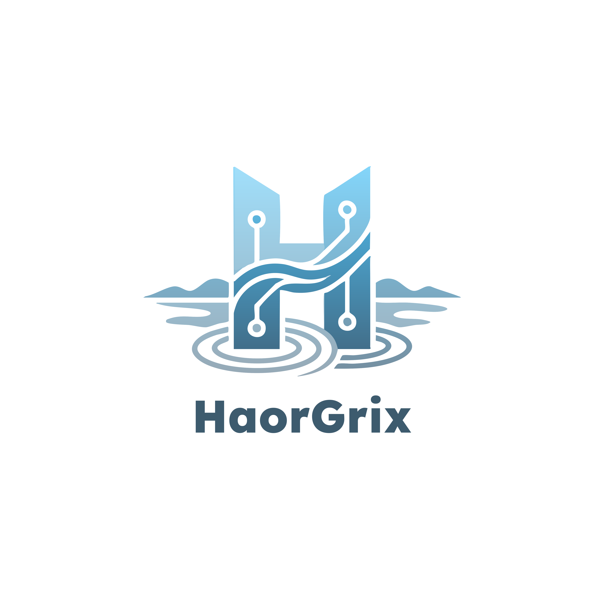

<div align="center">



<br/><br/>


<br/>

[](https://git.io/typing-svg)

<!-- Social Badges -->
<p>
<a href="https://haorgrix.com"></a>
<a href="mailto:haorgrix@gmail.com"></a>
<a href="https://github.com/HaorGrix"></a>
<a href="https://www.linkedin.com/company/haorgrix"></a>
</p>


</div>

---

## 🧰 Free Tools

**[85+ free developer & business tools →](https://haorgrix.com/tools)** — JSON/SQL formatters, PDF merge / compress / watermark / OCR, invoice / receipt / payslip generators with 19 templates, image tools, timezone & health calculators. 100% client-side: no uploads, no account, works offline.

Explore the full studio at **[haorgrix.com](https://haorgrix.com)**.

---

## About HaorGrix

We build intelligent systems for modern enterprises. From AI/ML pipelines to full-stack platforms to bespoke design systems, HaorGrix delivers production-grade engineering at the intersection of AI, software, and design.

```py
class HaorGrix:
    tagline   = "Build. Automate. Optimize. Scale."
    pillars   = ["AI & Data", "Software & Platforms", "Design & Growth"]
    based     = "Dhaka, Bangladesh"
    serves    = "Global enterprises and ambitious local businesses"
    stack     = ["Next.js", "FastAPI", "Python", "TypeScript", "PostgreSQL"]
```

-  **Enterprise AI & Data Systems** -- ML pipelines, computer vision, NLP, large-scale scraping, predictive modeling
-  **Software & Platform Engineering** -- custom SaaS, enterprise operations systems, internal tools, mobile apps
-  **Digital Experience & Growth** -- brand identity, conversion-optimized websites, marketing automation
-  **Productized Solutions** -- AI Receptionist, LMS, invoicing tools and more
-  **Engagement Models** -- end-to-end project delivery, dedicated teams, data & API licensing

---

## What We Do

### Enterprise AI & Data Systems
Computer vision, NLP, predictive models, anomaly detection, large-scale data ingestion, dataset curation and licensing, custom ML pipelines.

### Software & Platform Engineering
Custom SaaS platforms, enterprise operations systems, internal dashboards, customer portals, mobile apps, API integrations across the modern SaaS stack.

### Digital Experience & Growth
Brand identity systems, conversion-optimized websites and landing pages, marketing automation, lead generation engines, full digital launches.

---

## How We Work With You

| Engagement | Best For |
|---|---|
| **End-to-End Project Delivery** | Fixed-scope builds with clear deliverables and timelines |
| **Dedicated Engineering Teams** | Monthly retainer for ongoing product development |
| **Data & API Licensing** | Access our datasets and APIs without building software |

---

## Featured Products

### AI Receptionist & Clinic Management
Production-grade AI chat, appointments, prescriptions, queue, video consultations, and patient portal -- built for clinics that want one platform end-to-end.

[](https://github.com/HaorGrix/haorgrix-ai-receptionist)

### HaorGrix Edu Platform
A modern LMS for schools and coaching centers. Course delivery, scheduling, grading, payments. `Next.js` `Express` `Prisma` `TypeScript`.

[](https://github.com/HaorGrix/edu-platform)

### Invoice Generator
Free invoice generator built for Bangladesh -- BDT, USD, GBP, EUR and more. Used by freelancers and small businesses across the region.

[](https://github.com/HaorGrix/haorgrix-invoice-generator)

---

## Tech Stack

<div align="center">

**Frontend**


**Backend**


**Data & AI**


**Cloud & DevOps**


</div>

---

## Brand Palette

<div align="center">

|  |  |  |  |  |
|:---:|:---:|:---:|:---:|:---:|
| **Deep Steel** | **Steel Blue** | **Soft Sky** | **Pale Sky** | **Dark Steel** |
| `#3D5B6E` | `#57819B` | `#A9E0F6` | `#D4F0FB` | `#2E4A5A` |

</div>

---

## The Team

A multidisciplinary team of engineers, designers, and researchers shipping intelligent systems out of Dhaka, Bangladesh -- with collaborators across Toledo, Ohio and beyond. We have published research in IEEE venues, deployed AI in production, designed brand systems, and shipped over a dozen products to market.

---

<div align="center">

## Let's Build Something

```
> HaorGrix.connect("Intelligent systems for the next decade.")
```

<a href="mailto:haorgrix@gmail.com"></a>
<a href="https://github.com/HaorGrix"></a>
<a href="https://www.linkedin.com/company/haorgrix"></a>

<br/><br/>


<samp>[ HaorGrix ]  //  Build. Automate. Optimize. Scale.  //  Dhaka  ·  Toledo</samp>

</div>

---

<!-- ORG-ANALYTICS:START (auto-generated — do not edit by hand) -->
## 📊 Org Contribution Analytics

> **15** contributors · **35** repos with code · **1,736** commits · **+1,632,099 / −496,296** lines (net **1,135,803**) · refreshed weekly (Thu 18:00 BDT)

### Team leaderboard — lifetime, all repos

| | Contributor | Lines + | Lines − | Net | Commits | Repos | 30-day |
| :---: | :--- | ---: | ---: | ---: | ---: | ---: | :---: |
| <a href="https://github.com/AntardipHimel"></a> | [@AntardipHimel](https://github.com/AntardipHimel) | 528,855 | 152,404 | 376,451 | **194** | 13 | ▲ high |
| <a href="https://github.com/claude"></a> | [@claude](https://github.com/claude) | 270,509 | 5,834 | 264,675 | **150** | 12 | ▲ high |
| <a href="https://github.com/quantummed-jcm"></a> | [@quantummed-jcm](https://github.com/quantummed-jcm) | 180,443 | 155,107 | 25,336 | **161** | 1 | △ active |
| <a href="https://github.com/MusfiqurTuhin"></a> | [@MusfiqurTuhin](https://github.com/MusfiqurTuhin) | 160,074 | 33,730 | 126,344 | **560** | 34 | ▲ high |
| <a href="https://github.com/Prithweeraj-Acharjee"></a> | [@Prithweeraj-Acharjee](https://github.com/Prithweeraj-Acharjee) | 93,800 | 12,792 | 81,008 | **180** | 7 | ▲ high |
| <a href="https://github.com/soumitapaul344"></a> | [@soumitapaul344](https://github.com/soumitapaul344) | 92,373 | 78,408 | 13,965 | **48** | 4 | △ active |
| <a href="https://github.com/abakerQMS"></a> | [@abakerQMS](https://github.com/abakerQMS) | 74,310 | 32,417 | 41,893 | **70** | 1 | △ active |
| <a href="https://github.com/sudipabiswas"></a> | [@sudipabiswas](https://github.com/sudipabiswas) | 66,205 | 8,814 | 57,391 | **166** | 6 | △ active |
| <a href="https://github.com/sampannamahapatra"></a> | [@sampannamahapatra](https://github.com/sampannamahapatra) | 40,560 | 2,923 | 37,637 | **31** | 3 | △ active |
| <a href="https://github.com/jkula-quantummed"></a> | [@jkula-quantummed](https://github.com/jkula-quantummed) | 30,976 | 2,877 | 28,099 | **53** | 1 | ▵ light |
| <a href="https://github.com/cursoragent"></a> | [@cursoragent](https://github.com/cursoragent) | 28,749 | 5,344 | 23,405 | **22** | 5 | △ active |
| <a href="https://github.com/tanviralomrj1-hub"></a> | [@tanviralomrj1-hub](https://github.com/tanviralomrj1-hub) | 25,561 | 1 | 25,560 | **2** | 1 | ▵ light |
| <a href="https://github.com/shimonenator"></a> | [@shimonenator](https://github.com/shimonenator) | 21,313 | 2,643 | 18,670 | **9** | 1 | ▵ light |
| <a href="https://github.com/Afroza2"></a> | [@Afroza2](https://github.com/Afroza2) | 18,211 | 2,995 | 15,216 | **88** | 7 | ▵ light |
| <a href="https://github.com/prithweeraj-porag"></a> | [@prithweeraj-porag](https://github.com/prithweeraj-porag) | 160 | 7 | 153 | **2** | 1 | ▵ light |
| | **Total** | **1,632,099** | **496,296** | **1,135,803** | **1,736** | 35 | |

### Repositories

| Repository | Lines + | Lines − | Commits | Contributors | 30-day |
| :--- | ---: | ---: | ---: | ---: | :---: |
| [haorgrix_server](https://github.com/HaorGrix/haorgrix_server) | 628,928 | 129,373 | 5 | 3 | ▵ light |
| [quanMedTest](https://github.com/HaorGrix/quanMedTest) | 333,004 | 198,781 | 438 | 8 | ▲ high |
| [Pi-credit-saas](https://github.com/HaorGrix/Pi-credit-saas) | 104,869 | 21,705 | 441 | 4 | ▲ high |
| [edu-platform](https://github.com/HaorGrix/edu-platform) | 90,678 | 22,194 | 85 | 5 | ▵ light |
| [project_management](https://github.com/HaorGrix/project_management) | 60,441 | 44,862 | 28 | 2 | ▵ light |
| [image_tools](https://github.com/HaorGrix/image_tools) | 44,194 | 7,417 | 26 | 5 | ▵ light |
| [Musical-shop_sampanna-](https://github.com/HaorGrix/Musical-shop_sampanna-) | 42,285 | 4,912 | 9 | 3 | ▵ light |
| [haorgrix-ai-receptionist](https://github.com/HaorGrix/haorgrix-ai-receptionist) | 36,988 | 5,989 | 72 | 4 | △ active |
| [FoodDash](https://github.com/HaorGrix/FoodDash) | 34,412 | 7,249 | 130 | 4 | ▵ light |
| [website](https://github.com/HaorGrix/website) | 26,820 | 35,193 | 92 | 6 | △ active |
| [electroscale_Tanvir](https://github.com/HaorGrix/electroscale_Tanvir) | 25,711 | 1 | 3 | 2 | ▵ light |
| [dev_tools](https://github.com/HaorGrix/dev_tools) | 24,264 | 5,152 | 11 | 4 | ▵ light |
| [mcp-servers](https://github.com/HaorGrix/mcp-servers) | 24,217 | 3,534 | 8 | 1 | ▵ light |
| [haorgrix-console](https://github.com/HaorGrix/haorgrix-console) | 23,625 | 356 | 73 | 3 | ▲ high |
| [aura.skin_soumita](https://github.com/HaorGrix/aura.skin_soumita) | 21,642 | 2,684 | 13 | 4 | △ active |
| [haorgrix-tasks](https://github.com/HaorGrix/haorgrix-tasks) | 17,577 | 2,763 | 147 | 6 | ▲ high |
| [Business-and-Finance-Tool](https://github.com/HaorGrix/Business-and-Finance-Tool) | 16,999 | 1,514 | 28 | 2 | ▵ light |
| [pdf_to_digital-test](https://github.com/HaorGrix/pdf_to_digital-test) | 14,317 | 286 | 3 | 2 | ▵ light |
| [motion-craft](https://github.com/HaorGrix/motion-craft) | 11,492 | 161 | 4 | 2 | ▵ light |
| [life-health-tools](https://github.com/HaorGrix/life-health-tools) | 8,827 | 0 | 3 | 3 | ▵ light |
| [linkedinScrap](https://github.com/HaorGrix/linkedinScrap) | 8,594 | 779 | 26 | 1 | ▵ light |
| [Productivity-tool](https://github.com/HaorGrix/Productivity-tool) | 8,148 | 0 | 2 | 2 | ▵ light |
| [furrycart_Sudipa](https://github.com/HaorGrix/furrycart_Sudipa) | 7,810 | 10 | 6 | 2 | ▵ light |
| [free-tools-document](https://github.com/HaorGrix/free-tools-document) | 6,313 | 1,126 | 32 | 3 | ▵ light |
| [timezone-conversion-tool](https://github.com/HaorGrix/timezone-conversion-tool) | 3,659 | 254 | 34 | 3 | ▵ light |
| [email-verifier](https://github.com/HaorGrix/email-verifier) | 3,381 | 0 | 2 | 2 | ▵ light |
| [podium_logo](https://github.com/HaorGrix/podium_logo) | 1,494 | 0 | 3 | 1 | ▵ light |
| [.github](https://github.com/HaorGrix/.github) | 322 | 0 | 3 | 2 | ▵ light |
| [demo-repository](https://github.com/HaorGrix/demo-repository) | 193 | 0 | 2 | 2 | ▵ light |
| [FootWear1.0_Soumen](https://github.com/HaorGrix/FootWear1.0_Soumen) | 151 | 0 | 1 | 1 | ▵ light |
| [Career-and-Job-Search-Tools](https://github.com/HaorGrix/Career-and-Job-Search-Tools) | 150 | 1 | 2 | 1 | ▵ light |
| [rayhan-premium-apparel-store](https://github.com/HaorGrix/rayhan-premium-apparel-store) | 150 | 0 | 1 | 1 | ▵ light |
| [Video-and-Audio-Tool](https://github.com/HaorGrix/Video-and-Audio-Tool) | 149 | 0 | 1 | 1 | ▵ light |
| [Social-Media-Tool](https://github.com/HaorGrix/Social-Media-Tool) | 149 | 0 | 1 | 1 | ▵ light |
| [adjudicate-care](https://github.com/HaorGrix/adjudicate-care) | 146 | 0 | 1 | 1 | ▵ light |

### Org cadence (trailing 6 months)

| Month | Commits | Lines + | Lines − |
| :--- | ---: | ---: | ---: |
| 2026-02 | 0 | 0 | 0 |
| 2026-03 | 18 | 9,113 | 476 |
| 2026-04 | 135 | 183,856 | 50,872 |
| 2026-05 | 338 | 233,163 | 64,144 |
| 2026-06 | 487 | 807,798 | 162,230 |
| 2026-07 | 758 | 398,169 | 218,574 |

<sub>Auto-generated 2026-07-27 12:09 UTC · source: GitHub contributor statistics · bots excluded · lockfile/vendor churn not filtered (API-level counts)</sub>
<!-- ORG-ANALYTICS:END -->
